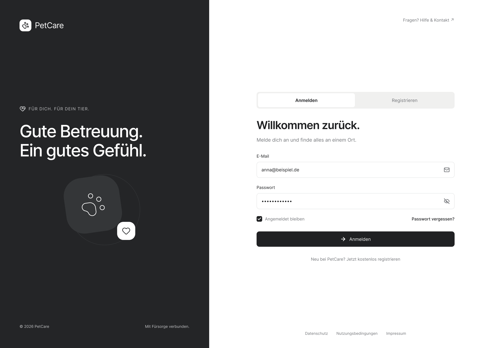
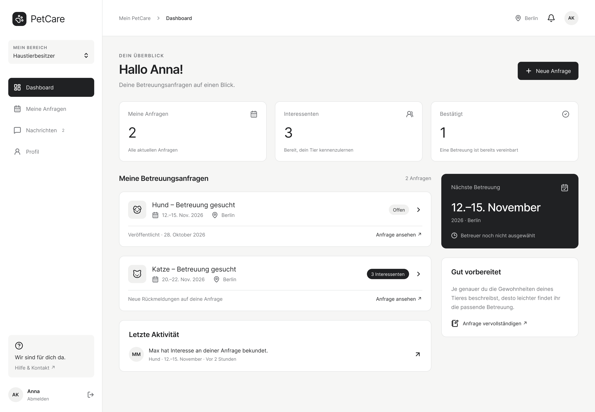
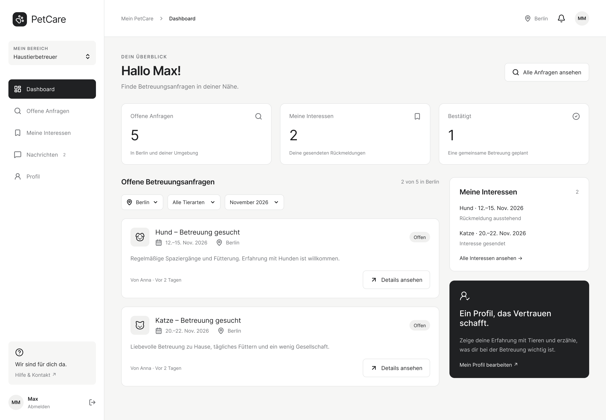
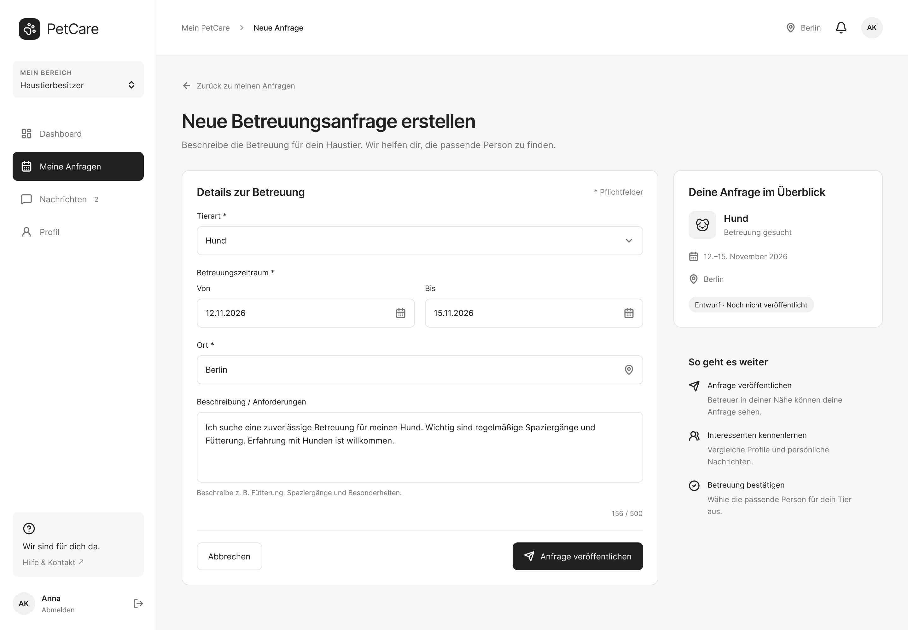
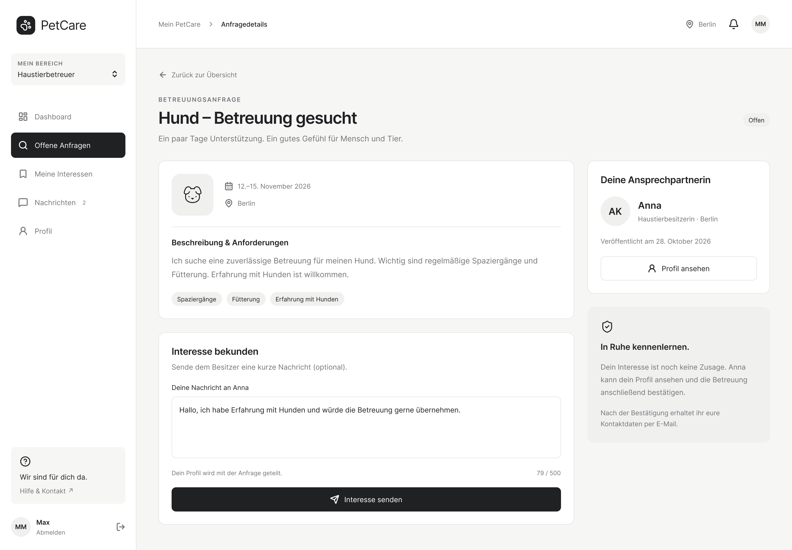
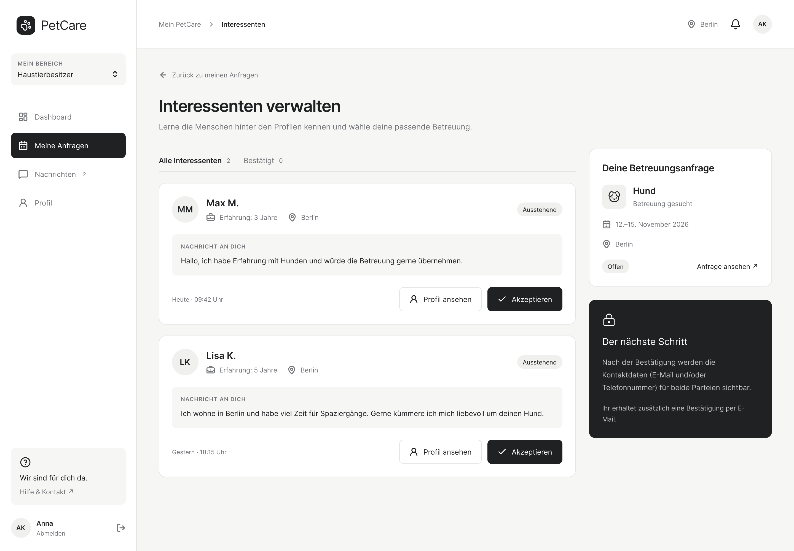

[← Documentation Home](README.md)

# Value Proposition

## Target Users and Their Problems

### Demand Side: Haustierbesitzer

Unsere erste Zielgruppe sind Haustierbesitzer, die beispielsweise aufgrund von Urlaub, Arbeit oder anderen Verpflichtungen zeitweise Unterstützung bei der Betreuung ihrer Haustiere benötigen.

Die Suche nach einer geeigneten Betreuung kann zeitaufwendig sein, da diese häufig über persönliche Kontakte oder unterschiedliche Kommunikationswege organisiert wird. Dadurch fehlt möglicherweise eine zentrale und übersichtliche Möglichkeit, Betreuungsanfragen zu veröffentlichen und Rückmeldungen zu verwalten.

### Supply Side: Haustierbetreuer

Die zweite Zielgruppe sind Personen, die bereit sind, zeitweise Haustiere anderer Menschen zu betreuen.

Für diese Personen kann es schwierig sein, passende Betreuungsmöglichkeiten zu finden, da entsprechende Anfragen nicht immer zentral verfügbar sind. Eine Plattform mit einer Übersicht offener Anfragen könnte ihnen die Suche nach passenden Betreuungsaufgaben erleichtern.

## Our Platform Solution

Petcare ist eine webbasierte Plattform, die Haustierbesitzer mit potenziellen Haustierbetreuern verbindet.

Ziel ist es, den Vermittlungsprozess durch die zentrale Erstellung, Suche und Verwaltung von Betreuungsanfragen für beide Nutzergruppen zu vereinfachen.

### Solution for the Demand Side

Haustierbesitzer können nach der Anmeldung eine Betreuungsanfrage erstellen. Diese enthält grundlegende Informationen wie Tierart, Betreuungszeitraum, Ort und besondere Anforderungen.

Sie erhalten eine Übersicht der interessierten Betreuer und können anschließend eine Person für die Betreuung auswählen und bestätigen.

### Solution for the Supply Side

Haustierbetreuer können sich auf der Plattform registrieren, offene Betreuungsanfragen einsehen und bei Interesse darauf reagieren.

Sie können den Bearbeitungsstatus ihrer Rückmeldungen verfolgen und erkennen, ob sie für eine Betreuung ausgewählt wurden.

## Happy Paths

### Demand-Side Happy Path

1. Ein Haustierbesitzer meldet sich bei Petcare an
2. Er erstellt eine Betreungsanfrage mit den erforderlichen Angaben
3. Interessierte Haustierbetreuer melden sich auf seine Anfrage
4. Der Haustierbesitzer sieht die Rückmeldungen und wählt einen Betreuer aus
5. Die Betreuung wird bestätigt und die Anfrage als vergeben markiert.

### Supply-Side Happy Path

1. Ein Haustierbetreuer meldet sich bei Petcare an
2. Er öffnet die Übersicht der verfügbaren Betreuungsanfragen
3. Er wählt eine passende Anfrage aus und bekundet sein Interesse
4. Er erhält eine Bestätigung, sobald der Haustierbesitzer ihn ausgewählt hat
5. Die bestätigte Betreuung erscheint in seiner Übersicht

---

## Initial Target Scope (as per Assignment)

Für die erste Version von PetCare planen wir folgende Benutzeroberflächen:

- Registrierung/Login: Auswahl der Rolle("Haustierbesitzer" oder "Haustierbetreuer" bei der Registrierung)
- Dashboard/Übersicht: Rollenabhängige Übersicht über eigene und offene Betreuungsanfragen und Interessensbekundungen
- Betreuungsanfrage erstellen: Formular zur Eingabe von Tierart, Zeitraum, Ort und Beschreibung
- Anfragedetails: Alle Informationen zur Betreuung(für Betreuer ein Button um Interesse zu zeigen; optional auch mit Nachricht an den Besitzer)
- Interessenten verwalten. Besitzer sehen interessierte Betreuer und können einen Betreuer auswählen(bei Bestätigung werden die freigegebenen Kontaktdaten für beide Parteien sichtbar)

*KI-Hinweis: Bei der sprachlichen
Ausarbeitung der Value Proposition wurde ChatGPT
unterstützend eingesetzt. Die Inhalte wurden
anschließend eigenständig überprüft und angepasst.

#### 1. Registrierung/ Login

#### 2. Dashboard Haustierbesitzer

#### 3. Dashboard Haustierbetreuer

#### 4. Anfrage erstellen

#### 5. Anfragedetails

#### 6. Interessenten

*KI-Hinweis: Die UI-Entwürfe wurden mithilfe von
Figma AI erstellt und überarbeitet.