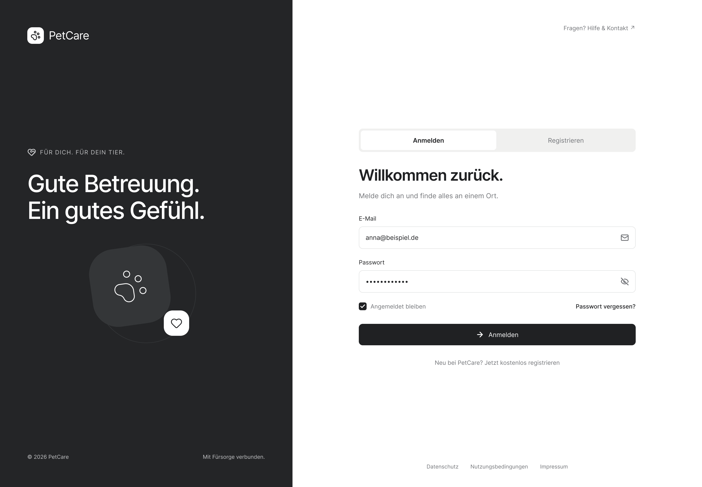
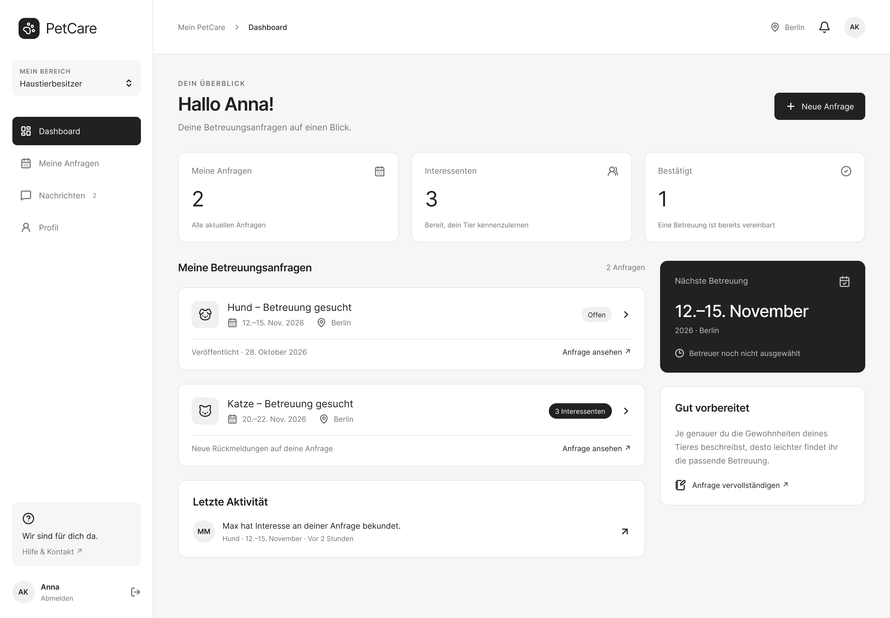
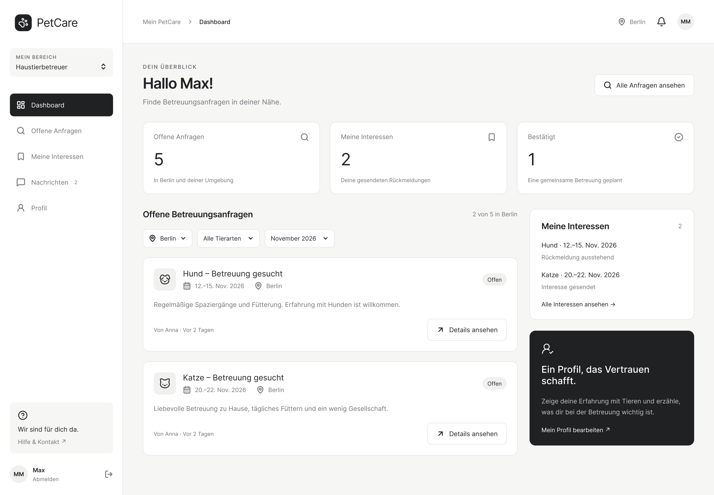
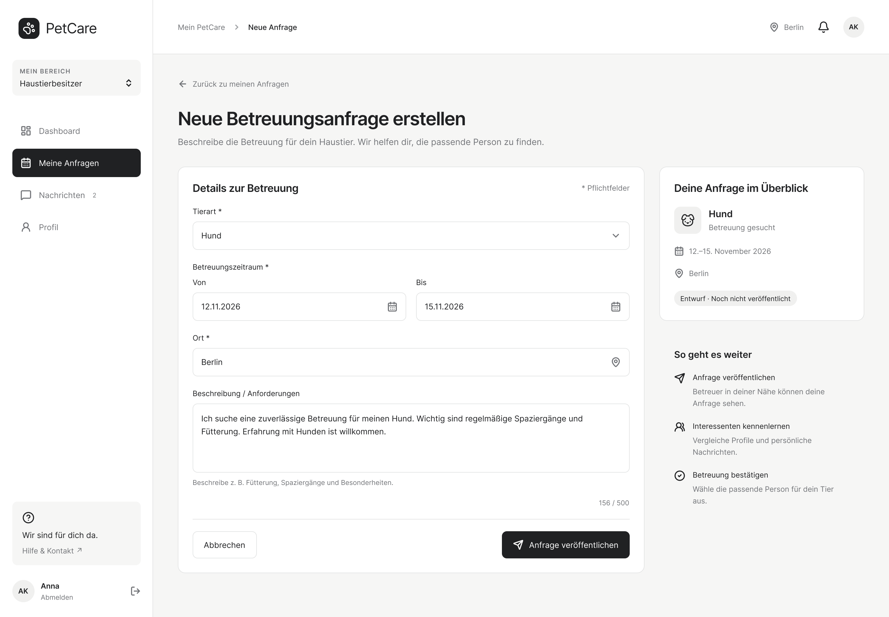
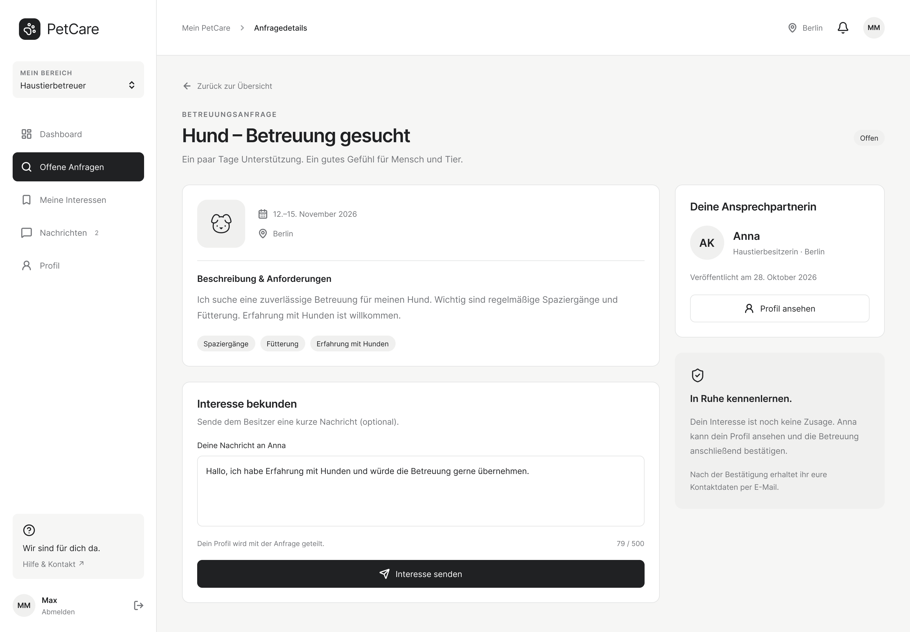
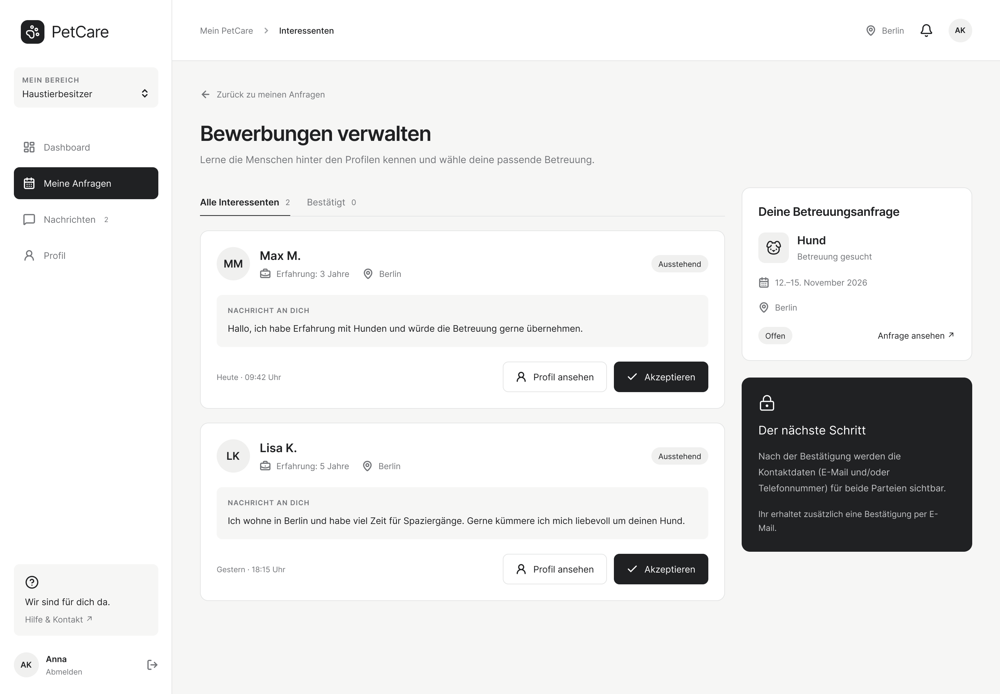
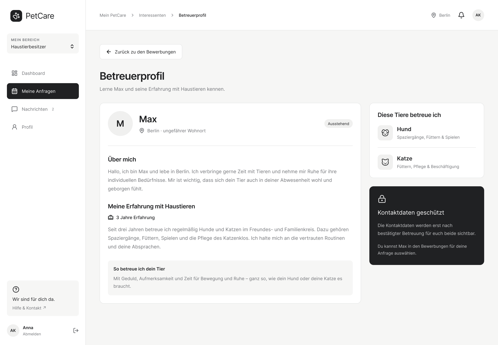

[← Documentation Home](README.md)

# Value Proposition

## Target Users and Their Problems

### Demand Side: Haustierbesitzer

Unsere erste Zielgruppe sind Besitzer von Hunden und Katzen, die beispielsweise aufgrund von Urlaub, Arbeit oder anderen Verpflichtungen zeitweise Unterstützung bei der Betreuung ihrer Haustiere benötigen.

Die Suche nach einer geeigneten Betreuung kann zeitaufwendig sein, da diese häufig über persönliche Kontakte oder unterschiedliche Kommunikationswege organisiert wird. Gerade bei der Betreuung von Haustieren spielt außerdem das Vertrauen in die betreuende Person eine wichtige Rolle.

### Supply Side: Haustierbetreuer

Die zweite Zielgruppe sind Personen, die bereit sind, zeitweise Hunde oder Katzen anderer Menschen zu betreuen.

Für diese Personen kann es schwierig sein, passende Betreuungsmöglichkeiten zu finden, da entsprechende Anfragen nicht immer zentral verfügbar sind. Gleichzeitig möchten sie ihre Erfahrungen und Kenntnisse im Umgang mit Haustieren darstellen können, um potenziellen Haustierbesitzern einen besseren Eindruck von ihrer Person zu vermitteln.

## Our Platform Solution

PetCare ist eine webbasierte Plattform, die Haustierbesitzer mit potenziellen Haustierbetreuern verbindet.

Für die erste Version konzentrieren wir uns auf die Betreuung von Hunden und Katzen. Dabei können auch die jeweilige Rasse und besondere Anforderungen des Haustiers berücksichtigt werden.

Ein Benutzerkonto kann für beide Nutzerrollen verwendet werden. Nutzer entscheiden bei der Registrierung zunächst, in welcher Rolle sie PetCare verwenden möchten, können die andere Rolle jedoch auch nachträglich aktivieren.

### Solution for the Demand Side

Haustierbesitzer können nach der Anmeldung eine Betreuungsanfrage erstellen. Diese enthält grundlegende Informationen wie Tierart, Rasse, Betreuungszeitraum, Ort und besondere Anforderungen.

Sie erhalten eine Übersicht der eingegangenen Bewerbungen und können die Profile der jeweiligen Betreuer einsehen. Dadurch können sie sich vor ihrer Entscheidung über die Person und deren Erfahrungen informieren.

Anschließend können sie einen Betreuer auswählen und die Betreuung bestätigen.

### Solution for the Supply Side

Haustierbetreuer können ein persönliches Profil mit Informationen zu ihrer Person, ihren Erfahrungen und den von ihnen betreuten Tierarten erstellen.

Sie können offene Betreuungsanfragen einsehen und sich bei Interesse darauf bewerben. Dabei besteht die Möglichkeit, eine kurze persönliche Nachricht an den Haustierbesitzer zu hinterlassen.

Nach erfolgreicher Bestätigung können beide Parteien ihre freigegebenen Kontaktdaten einsehen, um weitere Einzelheiten der Betreuung abzusprechen.

## Happy Paths

### Demand-Side Happy Path

1. Ein Haustierbesitzer registriert sich bei Petcare oder meldet sich an
2. Er erstellt eine Betreungsanfrage mit den erforderlichen Angaben
3. Interessierte Haustierbetreuer melden sich auf seine Anfrage
4. Der Haustierbesitzer sieht die eingegangenen Bewerbungen und kann die jeweiligen Betreuerprofile einsehen.
5. Die Anfrage wird als vergeben markiert und die freigegebenen Kontaktdaten werden für beide Parteien sichtbar..

### Supply-Side Happy Path

1. Ein Haustierbetreuer meldet sich bei Petcare an und erstell bei Bedarf sein Betreuerprofil
2. Er öffnet die Übersicht der verfügbaren Betreuungsanfragen
3. Er wählt eine passende Anfrage aus und bewirbt sich optional mit einer persönlichen Nachricht 
4. Der Haustierbesitzer kann seine Bewerbung und sein Profil einsehen.
5. Nach erfolgreicher Auswahl erhält der Betreuer eine Bestätigung.
6. Die bestätigte Betreuung erscheint in seiner Übersicht und die freigegebenen Kontaktdaten werden sichtbar.

---

## Initial Target Scope (as per Assignment)

Für die erste Version von PetCare planen wir folgende Benutzeroberflächen:

- Registrierung/Login: Auswahl der zunächst gewünschten Nutzerrolle("Haustierbesitzer" oder "Haustierbetreuer") Nutzer können die jeweils andere Rolle nachträglich aktivieren und zwischen beiden Ansichten wechseln.
- Dashboard/Übersicht: Rollenabhängige Übersicht über eigene und offene Betreuungsanfragen und Betreuungsanfragen
- Betreuungsanfrage erstellen: Formular zur Eingabe von Tierart(Hund oder Katze),Rasse,Zeitraum, Ort und Beschreibunbesonderen Anforderungen(Beschreibung)
- Anfragedetails: Alle Informationen zur Betreuung(für Betreuer ein Button um Interesse zu zeigen; optional auch mit Nachricht an den Besitzer)
-Betreuerprofil: Haustierbetreuer können Informationen zu ihrer Person, ihren Erfahrungen und den von ihnen betreuten Tierarten hinterlegen. Haustierbesitzer können diese Profile vor ihrer Entscheidung einsehen.
- Bewerbungen verwalten: Besitzer sehen interessierte Betreuer und können einen Betreuer auswählen(bei Bestätigung werden die freigegebenen Kontaktdaten für beide Parteien sichtbar)

*KI-Hinweis: Bei der sprachlichen
Ausarbeitung der Value Proposition wurde ChatGPT
unterstützend eingesetzt. Die Inhalte wurden
anschließend eigenständig überprüft und angepasst.

#### 1. Registrierung/ Login

#### 2. Dashboard Haustierbesitzer

#### 3. Dashboard Haustierbetreuer

#### 4. Anfrage erstellen

#### 5. Anfragedetails

#### 6. Bewerbungen verwalten

### 7. Betreuerprofil

*KI-Hinweis: Die UI-Entwürfe wurden mithilfe von
Figma AI erstellt und überarbeitet.